# Gateway API Benchmarks

> [!NOTE]
> This report is Part 3 of testing. Older versions can be found below:
> * [`v1` report](./README-v1.md)
> * [`v2` report](./README-v2.md)
>
> Note: each version tests different implementations and runs different tests, so it's worth looking through each one.

The Kubernetes [Gateway API](https://gateway-api.sigs.k8s.io/) aims to be the next-generation networking API for Kubernetes,
replacing the older [Ingress API](https://kubernetes.io/docs/concepts/services-networking/ingress/).

Like Ingress, it comes with a number of different implementations of the API.
These implementations have **wildly** different behaviors, strengths, and weaknesses that are not caught by the [conformance tests](https://gateway-api.sigs.k8s.io/docs/implementations/versions/v1.6/).

This repo aims to provide a comprehensive test suite that goes beyond the conformance tests, to help users better understand the real-world behavior of implementations.

## About the tests

*Disclaimer: Myself, and my employer, have associations and contributions to many of these projects (Istio, Envoy, Kgateway, Agentgateway). While I have attempted to minimize bias in this report, any testing has some bias. I encourage you to reproduce the results yourself!*
*Also: no part of this report is AI generated*

> [!NOTE]
> This test aims to provide factual reproducible data. However, past reports showed that some analysis about *why* certain implementations behave certain ways would be useful.
> When doing this, I will try to call out what is my opinion vs what is raw data.

## Table of contents

- [About the tests](#about-the-tests)
- [Overview](#overview)
- [Summary of findings](#summary-of-findings)
   * [Improved since last time](#improved-since-last-time)
- [Feature Coverage](#feature-coverage)
- [Architecture](#architecture)
- [Tests](#tests)
   * [Common Test Setup](#common-test-setup)
   * [Route Scale](#route-scale)
      + [Small scale](#small-scale)
      + [Large scale](#large-scale)
      + [Traffic during changes](#traffic-during-changes)
      + [Findings](#findings)
   * [ListenerSet Scale](#listenerset-scale)
      + [Findings](#findings-1)
   * [Route Changes](#route-changes)
      + [Route Propagation Delay](#route-propagation-delay)
      + [Route Modification Stability](#route-modification-stability)
      + [Deployment Changes](#deployment-changes)
      + [Invalid Configuration](#invalid-configuration)
      + [Attached Routes test](#attached-routes-test)
   * [Traffic Test](#traffic-test)
   * [Wrap up](#wrap-up)

# Overview

This test suite aims to cover any active, free, platform-agnostic (i.e. not a cloud vendor) implementation.

|                        | <br>Agentgateway | <br>Envoy Gateway | <br>Istio | <br>Kgateway | <br>Nginx | <br>Traefik |
|------------------------|--------------|---------------|---------|----------|---------------|---------------|
| Open Source            | ✅           | ✅            | ✅      | ✅       | ✅            | ✅            |
| Open Source Foundation | AAIF         | CNCF          | CNCF    | CNCF     | No foundation | No foundation |
| Dataplane Proxy        | Agentgateway | Envoy         | Envoy   | Envoy    | Nginx         | Traefik       |
| Tested Version         | v1.7.0       | v1.9.3        | v1.31.3 | v2.5.0   | v2.8.0        | v3.7.16       |


> [!TIP]  
> All projects under test utilize a proxy that has usage beyond Kubernetes/Gateway API.
> It's important to recognize that a high quality proxy does not, on its own, make a high quality Gateway API implementation.
> In the following tests, we will show even implementations that share the same proxy can have wildly different behaviors.

This set of implementations is chosen based on the [implementations submitting conformance reports](https://gateway-api.sigs.k8s.io/docs/implementations/versions/v1.6/), excluding closed source offerings and those that have minimal usage, then pruning a few out to keep the test set small.
(Note: at the time of writing this only excludes Cilium, which was primarily done because its deployment model makes it slightly complex to compare. See [`v1` report](./README-v1.md) for Cilium coverage!)

# Summary of findings

Because this report is long, I'll start with the summarized results.
This section is entirely my subjective analysis of the results, so I would encourage you to draw your own conclusions!

|                                                            | Agentgateway | Envoy Gateway                 | Istio                         | Kgateway                      | Nginx                               | Traefik                              |
|------------------------------------------------------------|--------------|-------------------------------|-------------------------------|-------------------------------|-------------------------------------|--------------------------------------|
| [Architecture](#architecture)                              | ✅           | ✅                            | ✅                            | ✅                            | ✅                                  | ❌ Gateways are not isolated         |
| [Route Scale](#route-scale) (est. yearly cost)             | $280         | $8,456 (30x)                  | $5,500 (20x)                  | $8,283 (30x)                  | ❌ $51,006 (182x), deadlocks        | $18,228 (65x)                        |
| [ListenerSet Scale](#listenerset-scale) (est. yearly cost) | $1,034       | $30,443 (29x)                 | $11,276 (11x)                 | $15,562 (15x)                 | $131,930 (128x)                     | ❌ Unsupported                       |
| [Route Propagation](#route-propagation-delay)              | ✅           | ✅                            | ✅                            | ✅                            | ✅                                  | ⚠️ 2s floor                          |
| [Route Modification](#route-modification-stability)        | ✅           | ❌ Errors during changes      | ✅                            | ✅                            | ❌ Errors during changes            | ✅                                   |
| [Deployment Changes](#deployment-changes)                  | ✅           | ✅                            | ✅                            | ✅                            | ❌ Errors during gateway rollout    | ❌ Errors during gateway rollout     |
| [Invalid Configuration](#invalid-configuration)            | ✅           | ❌ Blocks valid configuration | ❌ Blocks valid configuration | ❌ Blocks valid configuration | ✅                                  | ✅                                   |
| [Traffic](#traffic-test)                                   | ✅           | ✅                            | ✅                            | ✅                            | ❌ Poor throughput, port exhaustion | ⚠️ Doesn't scale to high concurrency |

Agentgateway:
* ✅ No issues were found.
* ✅ Lowest resource consumption across tests, at an estimated 11x-182x reduction in cost compared to others. ([source](#route-scale))

Envoy Gateway:
* 🚨 A single invalid route blocks all subsequent configuration updates, while reporting the route as accepted. ([source](#invalid-configuration))
* 🚨 During route updates, there is a temporary downtime for traffic. ([source](#route-modification-stability))
* ⚠️ Envoy `cluster`s are created per route rather than per service, which drives up data plane memory when many routes share a Service. ([source](#envoy-memory-usage-1))
* ⚠️ With ongoing churn of routes and pods, the control plane uses over 1 vCPU. ([source](#large-scale))
* ℹ️ The data plane generates a high number of metrics time series by default. ([source](#high-cardinality-metrics))

Istio:
* 🚨 A single invalid route blocks all subsequent configuration updates, while reporting the route as accepted. ([source](#invalid-configuration))
* ⚠️ Envoy `cluster`s are created for every Service port, including unused ones, roughly doubling data plane memory relative to Envoy Gateway in the route scale test. ([source](#envoy-memory-usage))
* ℹ️ Configuration updates are batched for up to 10s, trading propagation latency for lower network usage. ([source](#findings-2))

Kgateway:
* 🚨 A single invalid route blocks all subsequent configuration updates, while reporting the route as accepted. ([source](#invalid-configuration))
* ⚠️ Envoy `cluster`s are created for every Service port, including unused ones, roughly doubling data plane memory relative to Envoy Gateway in the route scale test. ([source](#envoy-memory-usage))
* ℹ️ The data plane generates a high number of metrics time series by default. ([source](#high-cardinality-metrics))

Nginx:
* 🚨 The controller deadlocks during configuration updates, permanently blocking all further changes until it is restarted. ([source](#nginx-deadlocks-during-configuration-update))
* 🚨 During route updates and gateway rollouts, there is a temporary downtime for traffic. ([source](#route-modification-stability))
* 🚨 Throughput is a fraction of other implementations, and sustained load fails requests due to ephemeral port exhaustion, as upstream connections are not reused by default. ([source](#traffic-test))
* ⚠️ Highest resource consumption, at an estimated 182x the cost of the most efficient implementation. ([source](#route-scale))
* ⚠️ Long-lived connections during configuration changes dramatically increase memory usage. ([source](#traffic-during-changes))
* ⚠️ Adding or removing a port causes all data plane pods to restart. ([source](#nginx-pod-churn))

Traefik:
* 🚨 All Gateways share a single Traefik instance and routing table, so a route in one namespace can take over traffic for another namespace's Gateway. This breaks the isolation that Traefik's own documentation recommends Gateway API for. ([source](#architecture))
* 🚨 During gateway rollouts, there is a temporary downtime for traffic. ([source](#deployment-changes))
* ⚠️ `ListenerSet` is not supported. ([source](#listenerset-scale))
* ⚠️ With ongoing churn of routes and pods, the control plane uses over 1 vCPU. ([source](#large-scale))
* ⚠️ Route propagation has a floor of 2s. ([source](#route-propagation-delay))
* ⚠️ Throughput does not scale to high connection counts as well as other implementations. ([source](#traffic-test))

## Improved since last time

Most of these tests also ran in the [`v1`](./README-v1.md#summary-of-findings) or [`v2`](./README-v2.md#summary-of-findings) report.
The table compares each result to the most recent previous report that tested that implementation.
Empty cells were good before and are still good; `-` means there is no previous result.

|                                                     | Agentgateway | Envoy Gateway                                             | Istio | Kgateway | Nginx                                  | Traefik                                       |
|-----------------------------------------------------|--------------|-----------------------------------------------------------|-------|----------|----------------------------------------|-----------------------------------------------|
| [Architecture](#architecture)                       |              | ⚠️ → ✅ (previously wrote resources into wrong namespace) |       |          | ⚠️ → ✅ (previously shared controller) | ❌ (false isolation)                          |
| [Route Scale](#route-scale)                         |              | ❌ → ✅ (previously leaked memory)                        |       |          | ❌ (deadlocks)                         | ❌ → ✅️ (previously failed to program)        |
| [ListenerSet Scale](#listenerset-scale)             |              | -                                                         |       | -        | -                                      | ⚠️ (unsupported)                              |
| [Route Propagation](#route-propagation-delay)       |              | ❌ → ✅ (previously gave 5xx errors)                      |       |          | ❌ → ✅ (previously failed at scale)   |                                               |
| [Route Modification](#route-modification-stability) |              | ❌ (still gives 5xx errors)                               |       |          | ❌ (still gives 5xx errors)            |                                               |
| [Traffic](#traffic-test)                            |              |                                                           |       |          | ❌ (poor throughput)                   | ⚠️ (does not scale to high connection counts) |

[Deployment Changes](#deployment-changes) and [Invalid Configuration](#invalid-configuration) are new tests in this report.

Resource consumption also appears to be down quite a bit across the board, but the numbers are hard to compare apples to apples across runs.

Kudos to all the implementations that have improved over the last year!

# Feature Coverage

While Gateway API comes with a set of conformance tests, unlike Kubernetes itself, the majority of the tests are _optional_.
Instead, each implementation specifies _which parts_ of the API they implement, and conformance just verifies that subset.

Below shows the coverage of features in v1.6:

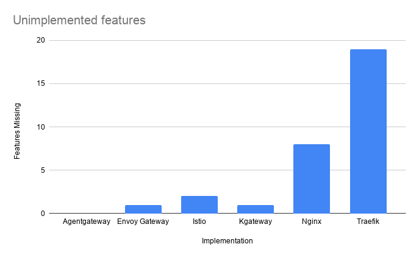

**Agentgateway** (0 missing)

**Envoy Gateway** (1 missing):
- Gateway HTTPS Listener Detect Misdirected Requests

**Istio** (2 missing):
- Gateway Backend Client Certificate
- Gateway HTTPS Listener Detect Misdirected Requests

**Kgateway** (1 missing):
- Gateway HTTPS Listener Detect Misdirected Requests

**Nginx** (8 missing):
- Backend TLS Policy SAN Validation
- HTTPRoute Backend Request Header Modification
- HTTPRoute Backend Timeout
- HTTPRoute Named Route Rule
- HTTPRoute Request Timeout
- HTTPRoute Retry
- HTTPRoute Retry Backend Timeout
- HTTPRoute Retry Connection Error

**Traefik** (19 missing):
- Backend TLS Policy SAN Validation
- Gateway Address Empty
- Gateway Backend Client Certificate
- Gateway Frontend Client Certificate Validation
- Gateway Frontend Client Certificate Validation Insecure Fallback
- Gateway HTTP Listener Isolation
- Gateway HTTPS Listener Detect Misdirected Requests
- Gateway Infrastructure Propagation
- Gateway Static Addresses
- HTTPRoute Backend Timeout
- HTTPRoute CORS
- HTTPRoute Request Mirror
- HTTPRoute Request Multiple Mirrors
- HTTPRoute Request Percentage Mirror
- HTTPRoute Request Timeout
- HTTPRoute Retry
- HTTPRoute Retry Backend Timeout
- HTTPRoute Retry Connection Error
- Listener Set

The remainder of the report will be focused on custom tests developed in this repository.

# Architecture

Below provides a high level overview of the architectures of each project. With one exception, none of these is "correct/incorrect".

|                                   | Agentgateway       | Envoy Gateway                               | Istio                  | Kgateway | Nginx                                     | Traefik                   |
|-----------------------------------|--------------------|---------------------------------------------|------------------------|----------|-------------------------------------------|---------------------------|
| Proxy                             | Agentgateway       | Envoy                                       | Envoy                  | Envoy    | Nginx                                     | Traefik                   |
| Proxy language                    | Rust               | C++                                         | C++                    | C++      | C                                         | Go                        |
| Controller language               | Go                 | Go                                          | Go                     | Go       | Go                                        | Go                        |
| Controller and proxy developed in | Same repo          | Same org                                    | Neither                | Neither  | Same org                                  | Same repo                 |
| Control plane / data plane split  | ✅                 | ✅                                          | ✅                     | ✅       | ✅                                        | ❌ Single binary          |
| Deployment per Gateway            | ✅                 | ✅ (in Gateway namespace is opt-in)         | ✅                     | ✅       | ✅                                        | ❌ Shared by all Gateways |
| Config delivery                   | xDS (custom types) | xDS                                         | xDS                    | xDS      | Agent writes files + reload               | In-process                |

The terms "Control plane" and "Data plane" are worth defining for those not familiar.
The 'Control plane' or controller is the process watching the cluster and programming the proxy or 'data plane'.
All implementations except Traefik have a split control/data plane architecture; Traefik has both embedded into one Deployment/container.

| Split                                                           | Joined                                                                |
|-----------------------------------------------------------------|-----------------------------------------------------------------------|
| 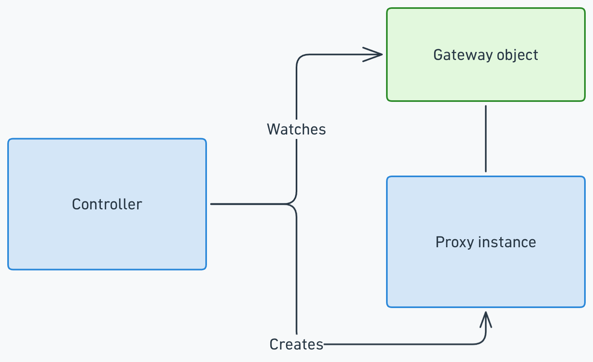 | 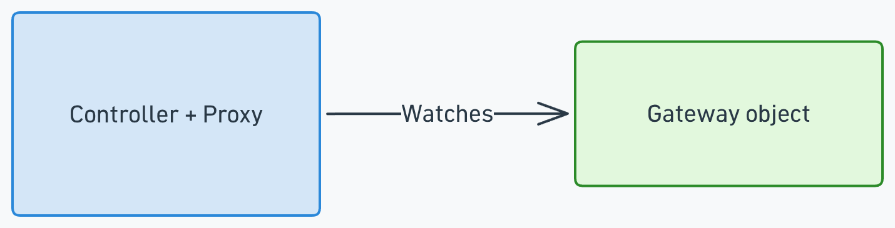 |

While it is valid to have a joined architecture (as seen in [`v1` report](./README-v1.md), Cilium) and correctly implement Gateway API, this is not the case for Traefik.
I set up [a test](./tests/traefik-tenancy.yaml) that sets up two Gateways with their own independent routes, in different namespaces:

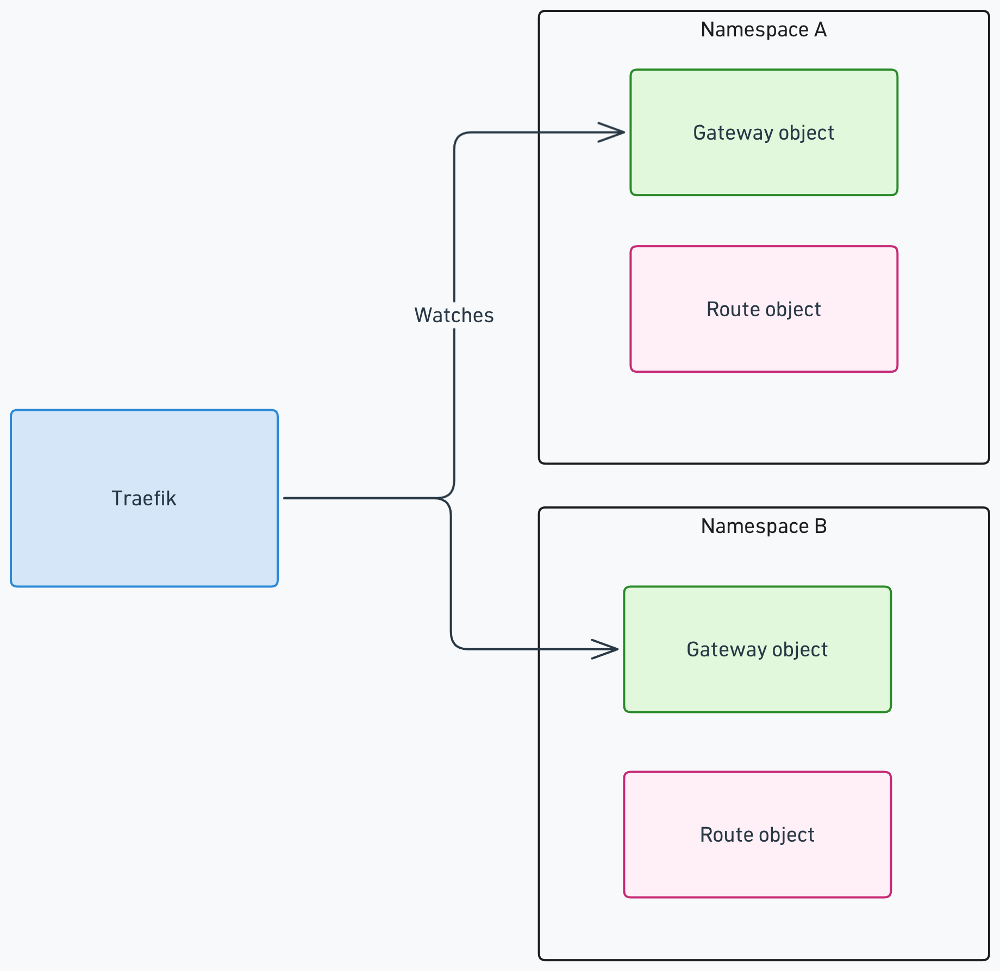

With this setup Traefik mixes the two routes across namespace A and namespace B.
All other implementations (and the Gateway API spec) treat Gateways as independent entities with their own set of configurations, IP addresses, etc.
Traefik [recommends Gateway API](https://doc.traefik.io/traefik/security/multi-tenant-kubernetes/#gateway-api) for its multi-tenancy guarantees, but its implementation doesn't actually offer these guarantees.

# Tests

## Common Test Setup

The test environment deploys a Grafana, Prometheus, and VictoriaLogs instance for monitoring.
Then, each implementation is deployed along with a `Gateway` for it.

This can all be set up by running `./install/basic.sh`.

The results on this post are run using a single node `kind` cluster on a 16-core AMD 9950x CPU with 96GB RAM.
Note that while this type of environment may be unrealistic for *traffic tests* (such as max QPS and latency), which are
typically much more appropriate to run in similar hardware to real world usage, most tests here are not sensitive to variations in hardware.
Using a single node cluster helps minimize noise (from implementations getting different results based on which others are co-scheduled, for example).

The recommended installation steps:

```shell
./install/basic.sh
```

The [Grafana dashboard](./dashboard.json) can be imported for visualizing the test results.

## Route Scale

First up, we start with a simple test: create a large number of routes, services, and pods.
Once the initial set of resources is created, a resource is modified (such as editing an HTTPRoute, or adding/removing a Pod).
The resource utilization of the gateway control and data planes is recorded.

To reproduce this test, run `./tests/route-load.sh <namespace count> <routes per namespace>`.

We will simulate a small cluster and a large cluster, with 10 namespaces with 10 routes each (100 total), and 50x100 (5,000 routes total).

### Small scale

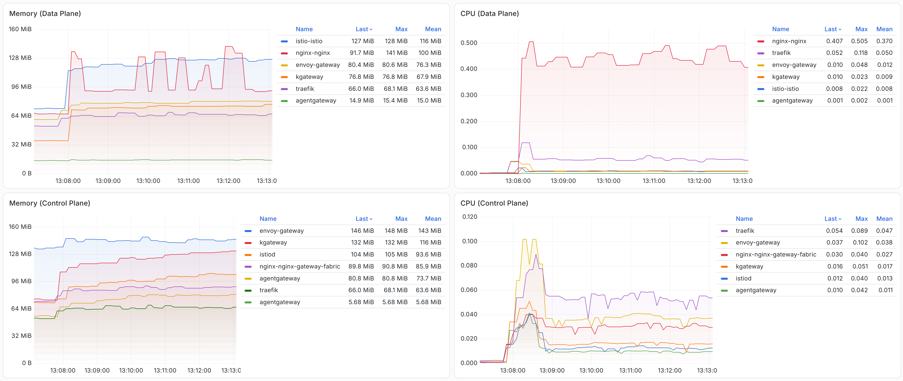

At small scale, we don't see too much interesting. While there is a spread of resource consumption, overall consumption is pretty low
as would be expected at a small scale.

One major standout is Nginx's CPU usage, which is at nearly 0.5 CPU to handle 100 routes.
While still not **that** much, it is 370x the most efficient implementation (Agentgateway) and 30x the Envoy-based implementations (which all came in around the same).

### Large scale

Scaling up to 5,000 routes things start to diverge more.

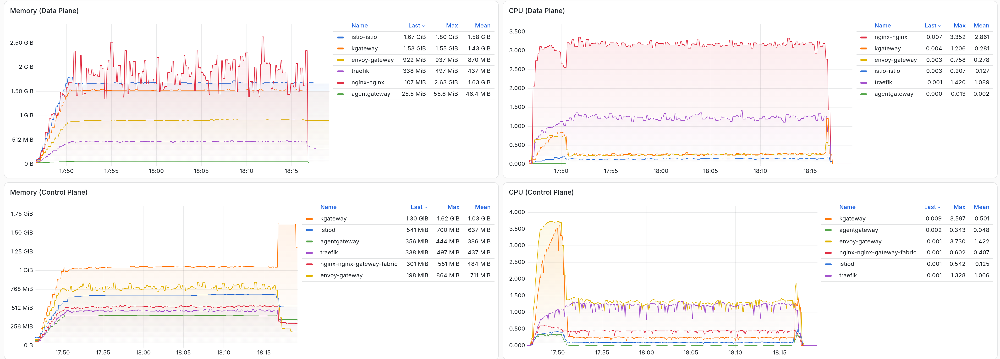

**Data plane memory** shows a substantial divergence and can be a substantial factor in costs in real world (have you seen the price of RAM these days??), as there are often many replicas.
Istio, Kgateway, and Nginx all use around ~1.6GB. The smallest footprint was Agentgateway, at 1/40th the footprint (40MB).
Envoy Gateway and Traefik fell in the middle at 900MB and 400MB respectively.

**Data plane CPU** continues to see Nginx using substantially more than other implementations, with the Envoy based implementations in the 0.1-0.3 vCPU range (more on the spread below), and Agentgateway at near-zero.
Traefik is hard to analyze due to its [architecture](#architecture).

**Control plane CPU** shows most implementations spiking during the initial phase (applying lots of config quickly) and then reaching a steady state (modifying a config/pod every so often), with Envoy Gateway and Kgateway seeing substantially larger spikes.
However, the steady state is generally the more important area (unless you are constantly creating 5,000 routes at once?), and where there is more divergence.
Envoy Gateway and Traefik both use over 1 vCPU, with the others quite a bit lower (Nginx 0.36, Kgateway 0.25, Istio 0.08, Agentgateway 0.008).

**Cleanup**: new to the v3 report, I also looked at cleaning up all of the resources to get back to a near-empty cluster.
All implementations dropped to near-zero CPU. Most implementations dropped control plane memory down a bit (but not back to their starting levels), with the exception of Kgateway which actually had an increase (presumably handling the spike of the teardown).
On the data plane, the 3 Envoy-based implementations (Kgateway, Istio, Envoy Gateway) all were completely unchanged - no memory was freed; the other three implementations dropped (though Traefik only trimmed off about 25% of its peak memory).

---

To put things into perspective, I priced out what it would look like to run these in a real cloud environment:

| Implementation | Data plane  | Control plane | Total (per year) | Relative |
|----------------|-------------|---------------|------------------|----------|
| Agentgateway   | $127        | $153          | $280             | 1x       |
| Envoy Gateway  | $6,039      | $2,417        | $8,456           | 30x      |
| Istio          | $5,181      | $319          | $5,500           | 20x      |
| Kgateway       | $7,200      | $1,083        | $8,283           | 30x      |
| Nginx          | $50,262     | $744          | $51,006          | 182x     |
| Traefik        | $18,228     | -             | $18,228          | 65x      |

<details>
<summary>How this was calculated</summary>

Calculation is a wild estimate based on AWS on-demand pricing:
* $38.94 per GB of RAM per year ($0.004445/GB-hour)
* $354.6 per vCPU per year ($0.04048/vCPU-hour)
* 3 controller replicas
* 30 data plane replicas
* 1.5 bin packing factor
* Peak (max) memory and average (mean) CPU from the large scale test above
* Traefik has no separate control plane, so it is only counted as data plane replicas

</details>

### Traffic during changes

The above tests simply configure the gateway without actual traffic.
A common problem in gateways is how to handle traffic during a configuration change, and the impact that may have on memory.
For example, some proxies reload configuration by cloning their state and keeping existing connections on the old process, while others allow incremental updates.

In this test, we run the same route scale test, but run `tests/keepalive.sh` at the same time, which constantly sends 30s requests.

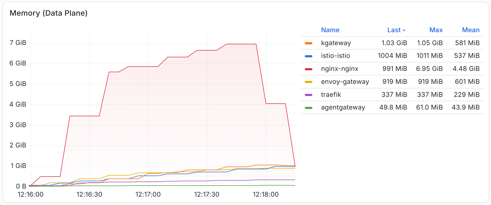

Nginx is the only proxy that is noticeably impacted by this test, showing dramatically increased memory from the traffic.

> [!NOTE]
> My guess is that this is based on Nginx persisting old copies of its worker's configuration to handle the existing traffic leading to copies of the same configuration.

### Findings

Through this test and subsequent investigation a number of findings beyond the raw numbers came up.

#### Nginx deadlocks during configuration update

During multiple tests I encountered a deadlock in Nginx.
This caused all configuration updates to be permanently blocked until Nginx was restarted.

I suspect this is the same root cause as [an issue](./README-v2.md#route-propagation-v2) I reported in the previous report.
This time I was able to debug it enough to open an issue: https://github.com/nginx/nginx-gateway-fabric/issues/6233.

> [!NOTE]
> None of the test results above show Nginx deadlocking; when it does deadlock its CPU instantly drops to 0%.
> I re-ran any tests that triggered the deadlock.

#### Envoy memory usage

An interesting divergence shows up on the data plane memory usage between Envoy Gateway and Istio/Kgateway, despite all three being Envoy-based - the latter both use ~2x the memory for the same configuration.

> [!NOTE]
> My guess is that this is due to how each project configures Envoy. The test has a Service with 2 ports, but Routes only use 1 port.
> * Envoy Gateway only configures the proxy with actively referenced Service/Ports.
> * Istio and Kgateway always send all Service/Ports even if they are not referenced by any Routes.

This same design difference does come with a tradeoff seen in the [route change](#route-changes) test though.

#### High cardinality metrics

One thing that surprised me a bit was that Istio's CPU usage was about 50% of Kgateway and Envoy Gateway, despite being the same proxy.

After some investigation, I found one factor: metric cardinality. Both Kgateway and Envoy Gateway produced _far_ more time series metrics than any other implementation:

| Implementation | Time Series |
|----------------|-------------|
| Agentgateway   | 58          |
| Envoy Gateway  | 331,972     |
| Istio          | 546         |
| Kgateway       | 371,843     |
| Nginx          | 41          |
| Traefik        | 50          |

This is not inherently a bad thing if the metrics are being used, but comes at a fairly high cost.

#### Network usage

Another thing I captured in this test is the network usage of each control plane during the test, which shows how much data is being sent from the control plane to the proxy.

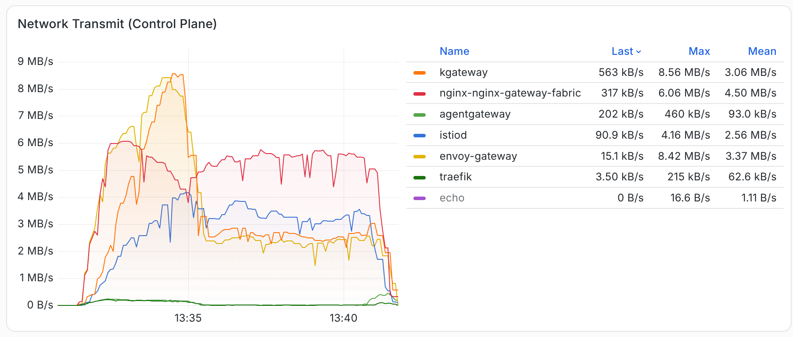

As one would expect, [Traefik's architecture](#architecture) results in near-zero traffic as there is no split control/data plane (the minimal usage, I assume, is from metrics scraping).
Surprisingly, Agentgateway's usage is similarly nearly as low.
The others use a range of 2-5MB/s - at this rate, cloud cross-AZ fees start to become a problem, so consider zonal placement if you have high configuration churn.

## ListenerSet Scale

One of the newer resources in Gateway API, [ListenerSet](https://gateway-api.sigs.k8s.io/guides/user-guides/listener-set/) allows users to create an `Ingress`-like experience with per-namespace domain and TLS settings.

This test is similar to the [Route Scale](#route-scale) test but with `ListenerSet`.

We create 50 namespaces, each with 50 "tenants". Each tenant has a Service + Pod, a ListenerSet with a wildcard hostname (`*.<tenant>.<namespace>.example.com`),
its own TLS certificate listing 16 hostnames, and 16 Routes (one per hostname).
In total this is 2,500 ListenerSets per Gateway, 2,500 certificates, and 40,000 Routes.

Traefik does not support `ListenerSet`, so it is excluded from the test (note: it does appear in the graphs below, but any usage is from processing configuration that does not apply to it).

To run the test: `./tests/listenerset-load.sh 50 50`.

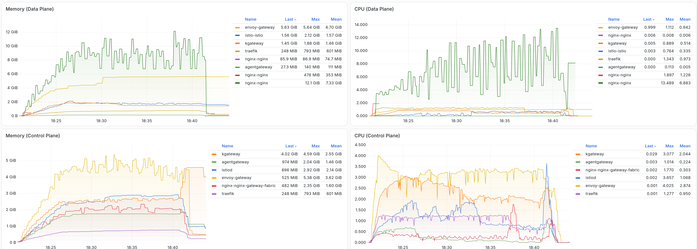

Overall, the results are roughly in line with the route scale test, with some divergence.
All of the controllers use more resources than in the route scale test, but the details vary.
For example, while the route scale test largely showed implementations have a peak during the initial phase and then a lower usage throughout the steady phase,
this was less apparent here: only Agentgateway had a noticeable decrease during the steady state phase. Nginx had a similar low-CPU footprint just without much of a spike at all.
Istio, Envoy Gateway, and Kgateway used substantially more CPU than the route test, with Envoy Gateway consuming roughly double the RAM of the others this time around. 

Like the route scale test, Nginx data plane continues to be the highest resource usage in CPU and memory.
Envoy Gateway uses about 2.5x the memory of Kgateway and Istio (more on this below).

Using the same [pricing estimate](#large-scale) as the route scale test:

| Implementation | Data plane  | Control plane | Total (per year) | Relative |
|----------------|-------------|---------------|------------------|----------|
| Agentgateway   | $319        | $715          | $1,034           | 1x       |
| Envoy Gateway  | $24,914     | $5,529        | $30,443          | 29x      |
| Istio          | $9,060      | $2,216        | $11,276          | 11x      |
| Kgateway       | $11,496     | $4,066        | $15,562          | 15x      |
| Nginx          | $131,035    | $895          | $131,930         | 128x     |

### Findings

#### Envoy memory usage

In the [route scale](#route-scale) test, we saw [Envoy Gateway](#envoy-memory-usage) use about half of the memory of Kgateway and Istio.
Here, however, we see the inverse: Envoy Gateway using 5.6GB while Istio and Kgateway are both around 2GB.

This seems to come back to the same design decisions that helped in the route scale test.
This test has 2,500 Services but 40,000 Routes (compared to 5,000 routes and services in the route scale test).
While Istio and Kgateway make an Envoy `cluster` per-Service, Envoy Gateway makes one per-Route.
A `cluster` is an internal Envoy concept representing a possible destination, and uses a fairly substantial amount of memory.

#### Nginx pod churn

If you look closely, you can see Nginx restarts at the start and end of the test.
This is due to the ListenerSet setup exposing a new port (443) for the first time.
Anytime the set of ports exposed changes, Nginx restarts the data plane.
No other implementation has this behavior.

## Route Changes

While the previous test investigates how each implementation scales with large configs, it's also important to see how they handle changes.
Ideally, an implementation should quickly apply changes with zero downtime.

### Route Propagation Delay

In this test, we create new routes and then wait for them to be ready, accepting a request on the route with a 200.
Additionally, we also check that the transition gracefully transitions from a `404` to a `200`.

First, we run incrementally: we apply a route and wait for all implementations to return a 200, and record how long they took.
Then we repeat 3,000 times. Traefik is skipped (`SKIP_SLOW`) for this test, as it was seen to have a floor of 2s which skews the results too much.

`SKIP_SLOW=true ./tests/probe.sh joined --routes=3000`

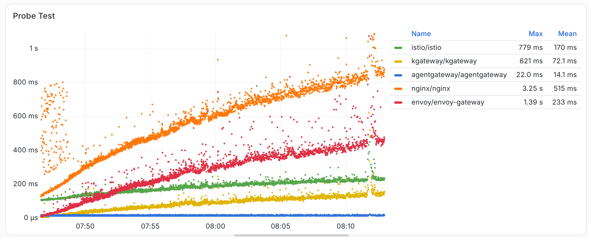

A variation of this applies routes as fast as possible while sending the same requests. This gives a different view of
how each gateway processes routes.

`./tests/probe.sh joined --routes=3000 --burst`

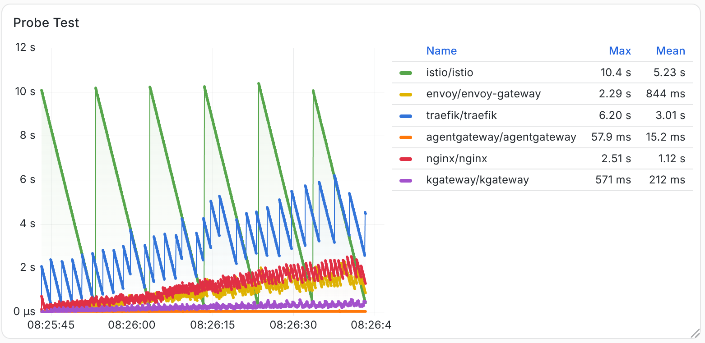

#### Findings

Overall, most implementations do reasonably here.
If you are running a serverless platform like [Knative](https://knative.dev/), low-latency route updates may be important, but for the most part the difference between 20ms and 2s is not really noticeable.

While all results fall in the range of acceptable, the burst test still provides some interesting insights.
Aside from Agentgateway, all implementations have a saw-tooth pattern. This indicates batching of updates.
For example, Istio specifically batches configuration changes for up to 10 seconds, leading to the 10s peaks we see.
As a side effect of that, we also see it using substantially less network than others:

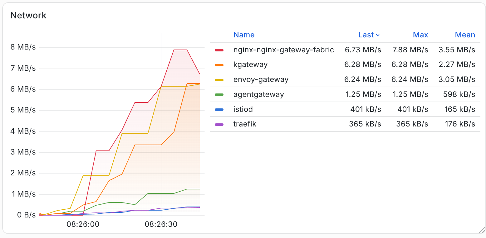

### Route Modification Stability

In this test, we do not create new routes but instead modify existing routes and ensure the change is zero-downtime.
This is an important test for production stability; while it's unlikely a _new_ route is going to get traffic within milliseconds,
existing routes already serving production traffic should not experience downtime.

`./tests/routechange.sh --iterations=20`

This test is a simple pass/fail: implementations must serve all 200s during the route changes.
2 of 6 implementations fail to safely update a route with zero downtime:

| Gateway       | Result | Reason                       |
|---------------|--------|------------------------------|
| Agentgateway  | ✅     |                              |
| Envoy Gateway | ❌     | 503s and 500s during changes |
| Istio         | ✅     |                              |
| Kgateway      | ✅     |                              |
| Nginx         | ❌     | 500s during changes          |
| Traefik       | ✅     |                              |

### Deployment Changes

Similar to [Route Modification Stability](#route-modification-stability), it's important for a gateway to maintain zero downtime during deployments.
This applies to both the gateway itself, as well as backends.

We can test this by sending traffic while doing a deployment rollout of the `backend` and `gateway`:

`./tests/rollout.sh --target=[backend|gateway]`

This test is a simple pass/fail: implementations must serve all 200s during a rollout of the backend and the gateway.

| Gateway       | Backend Rollout | Gateway Rollout |
|---------------|-----------------|-----------------|
| Agentgateway  | ✅              | ✅              |
| Envoy Gateway | ✅              | ✅              |
| Istio         | ✅              | ✅              |
| Kgateway      | ✅              | ✅              |
| Nginx         | ✅              | ❌              |
| Traefik       | ✅              | ❌              |

While all implementations handle a backend rollout gracefully, Nginx and Traefik experience errors on Gateway rollouts.

### Invalid Configuration

This test checks how the gateways handle invalid configuration. The test works in three phases:

1. Apply a valid config, ensure it works (everyone should pass this!).
2. Apply an invalid config.
3. Apply another valid config. This one should still apply.

The test is pass/fail: an implementation passes if the valid configuration applies, and fails if it is ignored.

This tests an important production capability: can one bad configuration take down the entire gateway?

`./tests/badconfig.sh` runs the test. Results:

| Gateway       | Invalid configuration doesn't block valid configuration |
|---------------|---------------------------------------------------------|
| Agentgateway  | ✅                                                      |
| Envoy Gateway | ❌                                                      |
| Istio         | ❌                                                      |
| Kgateway      | ❌                                                      |
| Nginx         | ✅                                                      |
| Traefik       | ✅                                                      |

Here the three Envoy-based implementations (Envoy Gateway, Istio, Kgateway) fail in the same manner: a single bad route blocks other routes from being updated.

### Attached Routes test

This test is a bit silly in terms of practical usage, but I like it since it showcases a bit of implementation differences, so I included it.

The `Gateway` object has a status field `attachedRoutes` that gives a count of the number of routes associated with it.

The attached route test creates a bunch of routes and polls the attached route count.

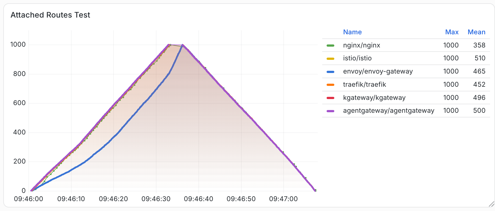

We can also look at the total number of writes:

| Gateway       | Writes |
|---------------|--------|
| Agentgateway  | 2000   |
| Envoy Gateway | 1789   |
| Istio         | 1390   |
| Kgateway      | 1964   |
| Nginx         | 341    |
| Traefik       | 1009   |

This shows similar batching as the [route propagation delay](#route-propagation-delay) test; all implementations except
Agentgateway batch up writes and have fewer writes than true updates in the cluster.
Envoy Gateway is the only implementation that struggles to keep the status update at "line rate"; in practice this likely has little real world meaning though.

## Traffic Test

This benchmark is primarily designed to test the _reliability_ and _scale_ of gateways.
Benchmarking runtime latency/throughput is a much harder problem (especially done correctly with minimal bias), and one that has been done by many others.

However, taking a coarse grained look at traffic is still useful.

**Take everything here with a grain of salt; this test is not optimized around giving reliable performance numbers.**

That being said, I ran a rough throughput test pushing maximum requests through the gateways at various concurrent connection counts.

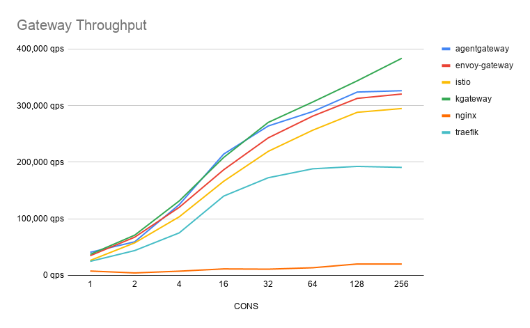

The results show the same as seen in [`v1` report](./README-v1.md):
* Traefik performs decently but fails to scale to higher connection counts as well as others.
* Nginx fails to scale up at all and suffers poor performance overall; this is entirely due to a default of not using keepalives to backends.
  This same default also caused the test to fail a number of times due to ephemeral port exhaustion. Nginx allows tuning this.
* The rest of the implementations were all in the same ballpark of one another; this test is not suitable for identifying small percentage differences.

## Wrap up

If you got this far, thank you for reading and I hope you enjoyed! Feel free to leave feedback in a GitHub issue.
